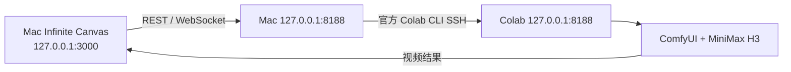

# 安全连接与验收边界

ComfyUI 不监听公网。`connect_colab_h3.sh` 仅使用官方 Colab CLI 对**已有、唯一**的 CLI 会话建立本地 SSH 转发，不新建或停止 GPU。画布浏览器通过 `/upload/image` 上传参考图、`/prompt` 提交工作流、`/ws` 获取进度，再经 `/history/{prompt_id}` 和 `/view` 取得结果。这些是画布已有 ComfyUI 渠道的接口；具体某次提交内容仍应从 ComfyUI 任务记录核对。

## 已检查的连接链路

CLI 0.8.0 OAuth 由账号持有人完成。独立 CPU 会话的官方 SSH 命令返回 `COLAB_SSH_OK`；后续 A100 会话由 CLI 创建，Drive 挂载后安装 ComfyUI 和模型。本机隧道连通后，Mac 的 `/system_stats` 返回 200，响应包含 `Access-Control-Allow-Origin: http://127.0.0.1:3000`；`/ws` 返回 101。画布也显示了 GPU 使用情况。工作流工坊导入 23 节点、26 连线并保存为首尾帧默认工作流。

用户后来报告画布生成成功。当前证据没有该次画布任务的 ComfyUI 提交 JSON、`prompt_id`、下载视频或 `ffprobe` 结果，所以不能确认它实际运行的是 4 步 Turbo 工作流、输出 10 秒 1344×768、有原生音轨，或自动保存到了 Drive。独立 Colab 10 秒 H3 实测见 [TEST_RESULTS.md](TEST_RESULTS.md)。

## 地址与断线

`restore_colab.py` 启动 ComfyUI 时限制 Origin 为 `http://127.0.0.1:3000`。若画布运行在其他 Origin，启动前用 CLI 的 `--env CANVAS_ORIGIN=...` 指定准确值；复用**已启动**的 ComfyUI 时脚本只检查健康，不会自动更改旧进程的 CORS 参数，须先确认实际响应头。

CLI SSH 会话有临时性，断开后先查 `colab sessions` 和已有云端产物。不要为恢复隧道盲目 `colab new`，避免重复计费。连接脚本退出仅断开转发，A100 仍持续计费，结束步骤见 [RUNBOOK.md](RUNBOOK.md)。若官方 SSH 在某个运行时不可用，改为从 Drive/Colab 下载 MP4、手动导入画布，别开放无认证公网 8188。
